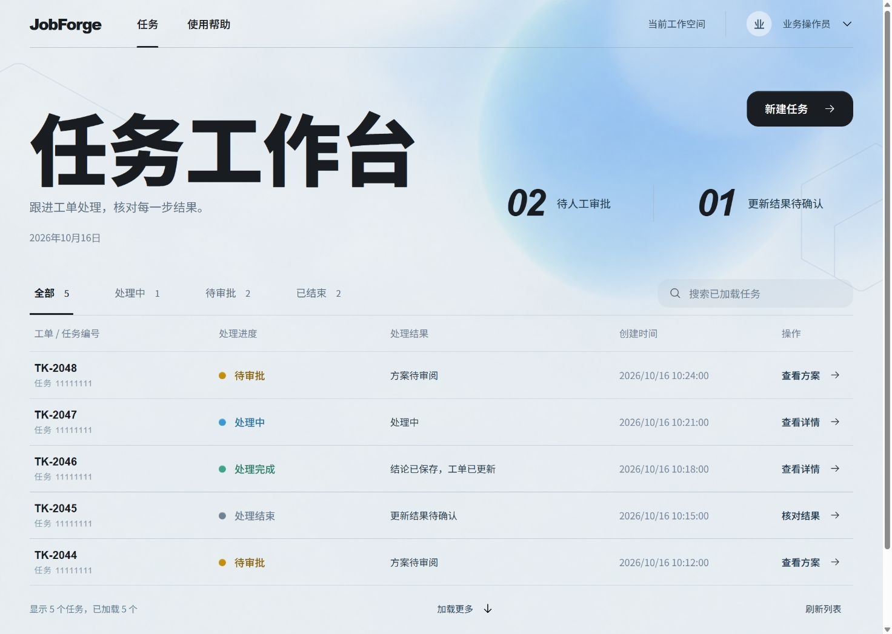

# JobForge

**Turn ticket, order, shipment and policy evidence into reviewable after-sales support proposals, then record human-approved decisions in tickets.**

[Demo video](https://github.com/XJfyrh/JobForge/releases/download/v0.1.0-preview.1/jobforge-demo.mp4) · [Free local Run](docs/quickstart.md) · [Scope](docs/support-overview.md) · [Engineering](docs/engineering.md) · [中文](README.md)



Go and PostgreSQL govern durable execution, leases, step commits, approvals and budgets. Python executes registered agent steps. Delivery is at-least-once; external effects require business idempotency and durable receipts.

## What it does

The support agent reads authorized ticket snapshots, order/shipment records and versioned policies. It proposes a supported conclusion, requests missing information, or recommends human follow-up. A separate approver reviews the original proposal before the business service records a conclusion or ticket flag and a receipt.

The available actions save a conclusion, request missing information, or mark a ticket for human follow-up. An independent approver authorizes each write, and the workbench shows the receipt confirming the update. Customer contact, dispatch, refunds, payments and ticket closure remain with the support team; see the [business scope](docs/support-overview.md).

## Evidence

On the frozen V9 unseen 20-case set, the Agent produced 18 correct proposals and 18 complete evidence cases; Fixed scored 11/20 on both. Paired results were 8 wins, 11 ties and 1 loss. The [report](docs/evidence/agent-v3-s5-v9-formal-v4-2026-10-16.md) includes every case, the two errors and the comparison conditions.

A [real crash demonstration](docs/evidence/agent-v3-s5-closeout-2026-10-16.md) confirmed one durable business receipt after a response was lost, reusing the committed model steps. Cost comparisons are recorded separately in the [recovery report](docs/evidence/agent-v3-s5-v9-recovery-2026-10-16.md).

## Try and evaluate

From the repository root, with Docker Compose available:

```sh
docker compose -f deploy/demo/compose.yaml up -d --build --wait
```

Open `http://127.0.0.1:8195/ui/` with `demo-operator`. Submit ticket `ticket-1` using the configured demo processing choice. Review with the separate `demo-approver` credential. Model responses, vectors and ledger amounts are synthetic; Run, approval and receipt paths use real isolated services. No cloud key is needed. First downloads/builds are separate from the warm-start experience; see the [Quickstart](docs/quickstart.md).

[Deployment readiness](docs/deployment.md) lists platform, configuration and recovery limits. Agent v3 currently has no production availability, end-to-end latency or disaster-recovery objectives. Existing legacy Job contracts remain valid.

See [API examples](examples/run-api/README.md), [contributing](CONTRIBUTING.md), [roadmap](ROADMAP.md) and [documentation](docs/README.md). [Apache-2.0](LICENSE); UI assets retain their [own licenses](internal/run/httpapi/ui/assets/README.md).
