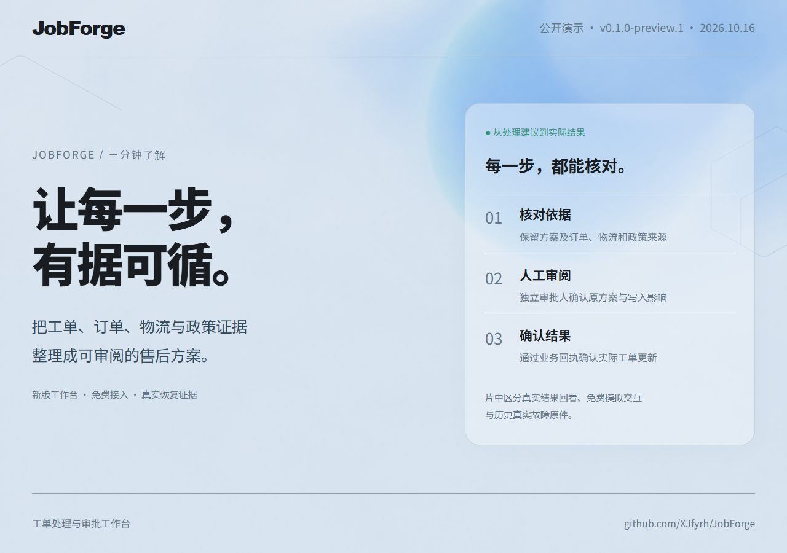
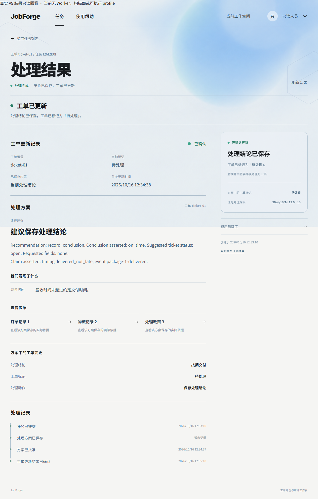

# 公开演示与免费复现

[三分钟MP4](https://github.com/XJfyrh/JobForge/releases/download/v0.1.0-preview.1/jobforge-demo.mp4) · [Preview附件与校验值](https://github.com/XJfyrh/JobForge/releases/tag/v0.1.0-preview.1) · [免费Run](quickstart.md)

## 录像来源

新片基于已合并PR #63的工作台，封面、片尾和信息条复用其浅色背景与字体，1280×900、15fps、180秒，原速节选，无配音。中英文WebVTT、封面、两段新版UI完整原片、标题卡可编辑来源、`video-sources.json`及SHA-256随Release分发。片段不是连续端到端计时。

| 时间 | 内容与来源 |
|---|---|
| 0–20秒 | 业务价值及操作闭环标题卡 |
| 20–80秒 | 原真实V9 Run在新版UI中的只读回看，展示结果、订单、物流引用和政策。API只允许GET，PG强制只读，没有Worker、扫描器或可执行profile |
| 80–125秒 | 新版UI隔离免费审批；模型响应、向量和账本金额模拟，真实Go/PG/Python、独立角色和业务回执 |
| 125–160秒 | 原真实故障和恢复后只读结果，保留旧UI版本标识；原POST仍为unknown，唯一回执确认applied |
| 160–180秒 | 原冻结候选结果、业务边界和接入入口 |

真实Run为`f26f2b0f-8a75-44ec-bd7c-6869e1bc1665`；免费审批录像Run为`a87ede28-0103-47cb-b625-e7eb59584bde`。真实结果及故障原件见[S5闭账报告](evidence/agent-v3-s5-closeout-2026-10-16.md)，此前零字节SDK录制原件继续保留。原业务首次更新时间12:34:38，最终确认12:35:10；自然lease/attempt期限没有缩短，新片未重跑模型或对原批次重新审批。

原方案的部分来源只保留引用、没有当前页面可展示的业务片段，界面明确说明；完整来源和评分结论以原始报告为准。Agent 18/20、Fixed 11/20及胜8/平11/负1属于V9冻结候选的未见20案，两案失败保留。

## 免费体验实测

Windows Docker Desktop、Linux容器、镜像已准备的环境中，`python -m tools.demo_smoke`得到真实Run `801e6011-461a-4cde-bef4-4c2880c91ff3`，提交到方案5.656秒、含独立审批及回执核对共6.875秒。模拟模型不代表真实推理延迟；首次下载和构建另计。启动后可在5分钟内完成页面体验，冷启动不作5分钟承诺。

最终入口镜像在停止后重启，`up -d --no-build --wait`实测12.094秒；随后新Run提交到方案6.594秒、含审批核对共7.797秒。两次机械体验均在5分钟目标内。完整冷下载/编译时间未测量。

检查覆盖401、只读身份403、提交重放、operator无审批权、错误方案hash拒绝、审批重放、工单版本只增加1及reconcile返回同一回执。Linux原生CI使用相同Compose和HTTP检查；最新结果从[CI](https://github.com/XJfyrh/JobForge/actions/workflows/ci.yml)进入。

一次完成后的容器内存快照约为demo 135MiB、PG 112MiB、入口16MiB；这是空闲时点值，不是峰值或最低配置。尚未建立生产资源基线。镜像、工具链和Docker本身需要额外资源。

演示最长90分钟，正常停止清理会话专用库，PG卷保留。免费运行时只连接内部网络，宿主入口为loopback代理。配置、停止和SDK命令集中于[Quickstart](quickstart.md)，当前生产适用性见[部署参考](deployment.md)。
