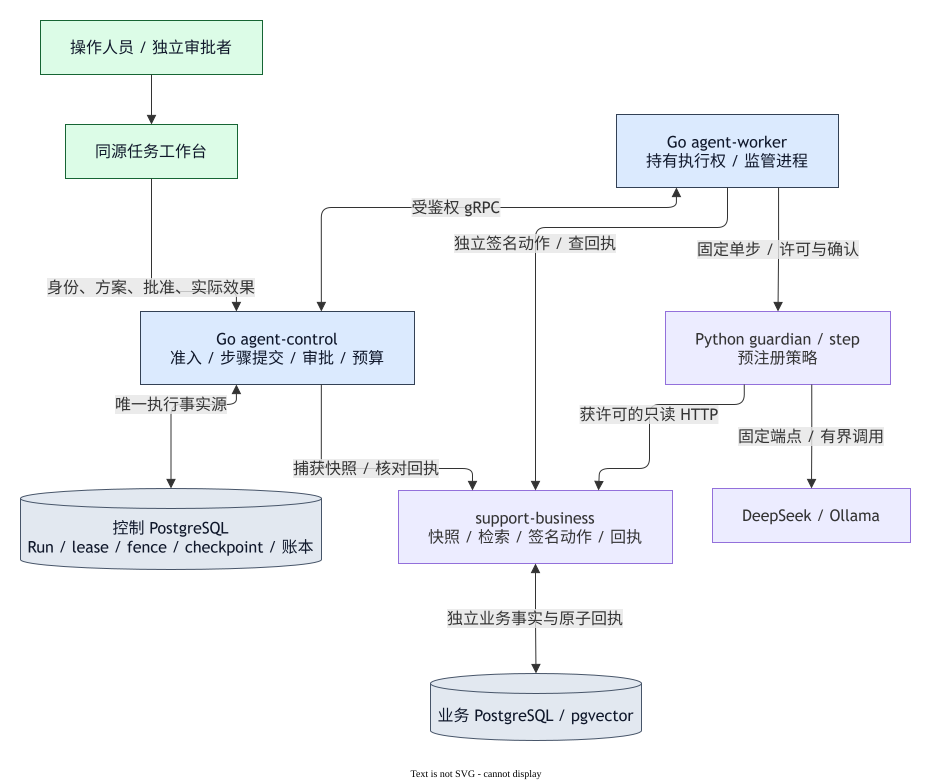
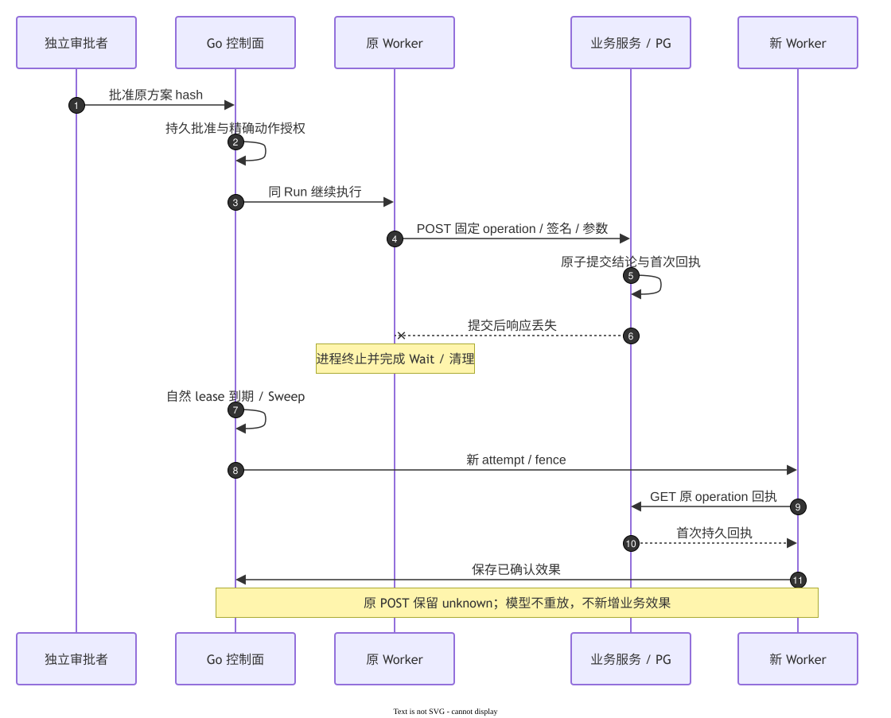

# 工程亮点与验证入口

JobForge将有界售后Agent放入持久执行、人工审批和费用控制的完整链路。运行机制与模型业务质量分别核验。

| 难题 | 实现选择 | 代码与验证 |
|---|---|---|
| Worker中断、旧进程迟到 | PG事务授予owner、lease、attempt与fence，提交校验完整身份，恢复读取已提交前缀 | [领域/存储](../internal/run)、[恢复合同](agent-v3/recovery.md)、[11项对照](evidence/agent-v3-s5-v9-recovery-2026-10-16.md) |
| 批准与实际写入不同步 | 原方案绑定、独立批准、Go签名动作、业务事务保存唯一回执，恢复先查回执 | [动作执行](../internal/runworker/action.go)、[业务服务](../internal/business)、[真实演示](evidence/agent-v3-s5-closeout-2026-10-16.md) |
| 超时后不知道是否收费 | 调用前预留，usage与普通观察分别确认，unknown保留hold，跨恢复累计 | [账本](../internal/run/postgres/ledger.go)、[供应商审计](agent-v3/provider-audit.md)、[真实PG/Linux检查](tests.md) |
| 正确结论仍可能包含错误依据 | 冻结候选、模型/参数、工具、来源与评分，保留未见集、Fixed对照和错答 | [正式对照](evidence/agent-v3-s5-v9-formal-v4-2026-10-16.md)、[评分工具](../tools/support_evaluation/README.md) |

## 业务提交后丢失响应

真实演示中原 POST 保留 unknown，自然 lease/Sweep 后新 attempt 读取原操作回执，复用已提交的模型步骤，工单版本只增加一次。[恢复对照](evidence/agent-v3-s5-v9-recovery-2026-10-16.md)另外比较成本：两组可比案例的续跑费用高于中断前缀加从头执行。图源为同目录的`.drawio`文件。

更多内容见[架构](architecture.md)和[部署参考](deployment.md)。
